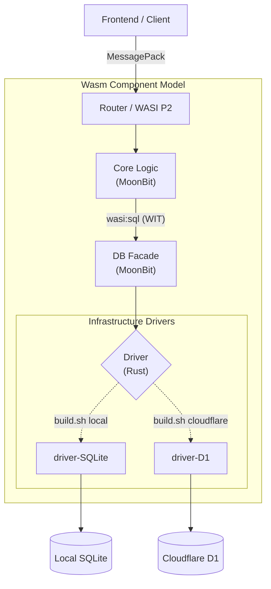

# 🚀 Multi-Target WASM CRUD Architecture

[](https://leptos.dev/)
[](https://moonbitlang.com/)
[](https://www.rust-lang.org/)
[](https://webassembly.org/)
[](https://developers.cloudflare.com/d1/)

WebAssembly Component Model (WASI P2) を活用し、**「1つのコアロジックでローカル(SQLite)とエッジ(Cloudflare D1)をシームレスに行き来する」** 完全マルチターゲットなCRUDアプリケーションです。
インフラ環境の差異はすべてWASMのコンポーネントレベルで吸収されるため、ソースコードを1行も変更することなくビルドターゲットを切り替えることができます。

## ✨ Features

- **Hexagonal Architecture via WASM Components**: コアロジック(MoonBit)とインフラ層を完全に分離。

- **Standardized Database Access (`wasi:sql`)**: WASIの標準提案である `wasi:sql` インターフェースを採用。特定のDB実装に依存しない抽象化を実現。

- **Zero-Code Target Switching**: `build.sh local` と `build.sh cloudflare` だけでストレージを切り替え。

- **Environment Normalization**: SQLite (`Int64`) と D1 (`Double`) のインフラ型差異を、MoonBit DBファサード層で自動正規化。

- **High Performance RPC**: フロントエンド・バックエンド間の通信には MessagePack を採用。

- **Rust Frontend (Leptos + TEA)**: RustのWebフレームワーク Leptos に The Elm Architecture (TEA) パターンを組み合わせ、堅牢な状態管理とUIを構築。
  
## 🏗️ Architecture

このプロジェクトは、WebAssembly Interface Types (WIT) を介して複数のWASMモジュール（MoonBitとRust）を `wac` によって結合する高度なコンポーネント指向アーキテクチャを採用しています。

  



  

### コンポーネントの役割

**Frontend (Leptos + TEA)**: Rustベースのフレームワークである Leptos を採用し、The Elm Architecture (Model-View-Update) パターンでUIと状態を堅牢に管理。バックエンドとの通信には MessagePack を用いたバイナリRPCを採用し、Rustの強力な型システムをフルスタックで共有しています
  
**backend-component (MoonBit)**: アプリケーションのビジネスロジック。インフラ（DBの種類）には一切依存しません。

**db-facade (MoonBit)**: CoreとDriverの仲介役。WITのライフサイクル管理や、SQLite/D1間のデータ型の揺れ（Int64 / Double）を正規化し、境界の文字コード（UTF-16）を維持します。

**DB Driver (Rust)**: 各ストレージに特化した低レイヤードライバ。WITを介してFacadeとリンクされます。

## 🛠️ Prerequisites

ビルドには以下のツールチェーンが必要です。

- [MoonBit CLI](https://docs.moonbitlang.com/en/latest/tools/cli.html) (Core / Facadeの開発)
- [Rust & Cargo](https://rustup.rs/) (Driverの開発)
- [cargo-component](https://github.com/bytecodealliance/cargo-component)
- [Wasm-tools](https://github.com/bytecodealliance/wasm-tools)
- [WAC (WebAssembly Compose)](https://github.com/bytecodealliance/wac)
- Node.js & Wrangler (Cloudflare デプロイ用)
## 🚀 Build & Run

ビルドスクリプトは、必要なスタブ生成 (`wit-bindgen`)、各言語のコンパイル、および `wac plug` によるコンポーネントの結合を全自動で行います。
### Local Development (SQLite)

ローカルでの高速なテストや開発にはSQLiteを使用します。

```bash

# ローカルSQLiteをターゲットにしてビルド
./build.sh local

# サーバーの起動
wasmtime serve -S cli=y --dir=. app.wasm

```

### Production Edge (Cloudflare D1)

本番環境のエッジワーカー向けにデプロイする場合はD1を使用します。

```bash

# Cloudflare D1をターゲットにしてビルド
./build.sh cloudflare

# ローカルシミュレーション (wrangler)
npx wrangler dev

# 本番デプロイ (GitHub Actionsにて自動化済)
npx wrangler deploy

```

## 🧠 Technical Highlights

開発プロセスにおいて、WASM Component エコシステムの最先端特有の課題を解決しています。

- **`wit-bindgen` Stub Management**: `--ignore-stub` を活用し、自動生成されるバインディングと手書きのロジック（型変換やグローバル状態保持）を安全に共存させています。

- **Canonical ABI & `jco` Optimization**: `wac plug` 結合時に発生する UTF-16 ⇔ UTF-8 の境界Shimによる `jco transpile` パニック（`utf16 copier` 未実装問題）を、両コンポーネントのエンコーディング定義を揃えることで回避・最適化しています。

- **D1の非同期問題の解決**: WASMからD1にアクセスする場合、一度JSまで制御を戻す必要がありますが、ドライバとCloudflare用のJS間でリプレイパターンを構築することで同期的なクエリ実行を実現しています。これによりコアロジックは非同期処理に汚染されません。

## 🛠️ Prerequisites (Environment)

本プロジェクトは **Dev Container** に完全対応しています。ローカルの環境を汚すことなく、複雑なWASMツールチェーンをすぐに利用できます。

### Option 1: Dev Container (Recommended)
VS Code と Docker があれば、リポジトリを開いて「Reopen in Container」を選択するだけで、必要なツール（MoonBit, Rust, wasm-tools, wac等）がすべて揃った環境が立ち上がります。

### Option 2: GitHub Codespaces
ブラウザ上ですぐに試したい場合は、リポジトリトップの `<> Code` ボタンから Codespaces を起動してください。1クリックで開発・ビルド環境が完成します。

### 🔑 Cloudflare Tokens (Edge Deploy)
Cloudflare D1 へのデプロイやエッジのシミュレーションを行う場合のみ、コンテナ内で以下のコマンドを実行してログイン（またはトークンを設定）してください。
（※ Local SQLite モードで遊ぶだけなら不要です）
```bash
npx wrangler login
```
## 📄 License
MIT License