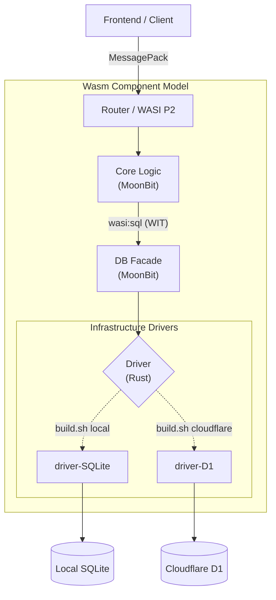

# 🚀 Multi-Target WASM CRUD Architecture

A fully multi-target CRUD application utilizing the WebAssembly Component Model (WASI P2) to seamlessly switch between local (SQLite) and edge (Cloudflare D1) environments using a single core logic.

All infrastructure differences are abstracted at the WASM component level, allowing you to switch build targets without changing a single line of source code.

## ✨ Features

- **Hexagonal Architecture via WASM Components**: Complete separation of the core logic (MoonBit) and infrastructure layers.
- **Standardized Database Access (`wasi:sql`)**: Adopts the `wasi:sql` interface, a standard WASI proposal, achieving database-agnostic abstraction.
- **Zero-Code Target Switching**: Switch storage backends simply by running `build.sh local` or `build.sh cloudflare`.
- **Environment Normalization**: Automatically normalizes infrastructure type differences—such as SQLite (`Int64`) and D1 (`Double`)—within the MoonBit DB facade layer.
- **High Performance RPC**: Utilizes MessagePack for binary communication between the frontend and backend.
- **Rust Frontend (Leptos + TEA)**: Combines the Rust web framework Leptos with The Elm Architecture (TEA) pattern to build robust state management and UI.

## 🏗️ Architecture

This project adopts an advanced component-oriented architecture, composing multiple WASM modules (MoonBit and Rust) via WebAssembly Interface Types (WIT) using `wac`.



### Component Roles

- **Frontend (Leptos + TEA)**: Uses Leptos, a Rust-based framework, to robustly manage UI and state using The Elm Architecture (Model-View-Update) pattern. Adopts binary RPC using MessagePack for backend communication, sharing Rust's powerful type system across the full stack.
- **backend-component (MoonBit)**: The business logic of the application. Strictly infrastructure-agnostic (independent of the DB type).
- **db-facade (MoonBit)**: The mediator between the Core and Driver. Handles WIT lifecycle management, normalizes data type variations (`Int64` / `Double`) between SQLite and D1, and maintains boundary character encoding (UTF-16).
- **DB Driver (Rust)**: Low-layer drivers specialized for each storage backend. Linked to the Facade via WIT.

## 🛠️ Prerequisites

The following toolchains are required for building:

- MoonBit CLI (for Core / Facade development)
- Rust & Cargo (for Driver development)
- cargo-component
- wasm-tools
- WAC (WebAssembly Compose)
- Node.js & Wrangler (for Cloudflare deployment)

## 🚀 Build & Run

The build script fully automates stub generation (`wit-bindgen`), compilation of each language, and component composition via `wac plug`.

### Local Development (SQLite)
We use SQLite for fast local testing and development.

```bash

# ローカルSQLiteをターゲットにしてビルド
./build.sh local

# サーバーの起動
wasmtime serve -S cli=y --dir=. app.wasm

```

### Production Edge (Cloudflare D1)
We use D1 for deploying to production edge workers.

```bash

# Cloudflare D1をターゲットにしてビルド
./build.sh cloudflare

# ローカルシミュレーション (wrangler)
npx wrangler dev

# 本番デプロイ (GitHub Actionsにて自動化済)
npx wrangler deploy

```

## 🧠 Technical Highlights

Throughout the development process, we resolved cutting-edge challenges unique to the WASM Component ecosystem.

- **`wit-bindgen` Stub Management**: Utilizes `--ignore-stub` to safely coexist auto-generated bindings with hand-written logic (such as type conversions and global state retention).
- **Canonical ABI & `jco` Optimization**: Avoids and optimizes the `jco transpile` panic (due to the unimplemented `utf16 copier`) caused by UTF-16 ⇔ UTF-8 boundary shims during `wac plug` composition by aligning the encoding definitions of both components.
- **Solving D1's Asynchronous I/O Problem**: When accessing D1 from WASM, control must momentarily return to JS. We achieved synchronous query execution by building a "Replay Pattern" between the driver and Cloudflare's JS environment. This prevents the core logic from being contaminated by asynchronous operations.

## 🛠️ Environment Setup

This project is fully compatible with **Dev Containers**. You can immediately utilize the complex WASM toolchain without polluting your local environment.

### Option 1: Dev Container (Recommended)
With VS Code and Docker, simply open the repository and select "Reopen in Container" to launch an environment fully equipped with all necessary tools (MoonBit, Rust, wasm-tools, wac, etc.).

### Option 2: GitHub Codespaces
If you want to try it immediately in your browser, launch Codespaces from the `<> Code` button at the top of the repository. Your development and build environment will be ready in one click.

### 🔑 Cloudflare Tokens (Edge Deploy)
Only when deploying to Cloudflare D1 or simulating the edge, run the following command inside the container to log in (or set up a token).
*(Not required if you are just playing around in Local SQLite mode)*

```bash
npx wrangler login
```

## 📄 License

MIT License